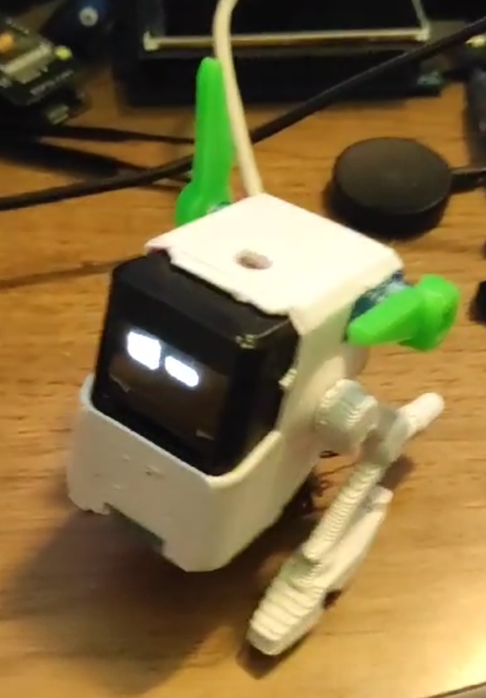
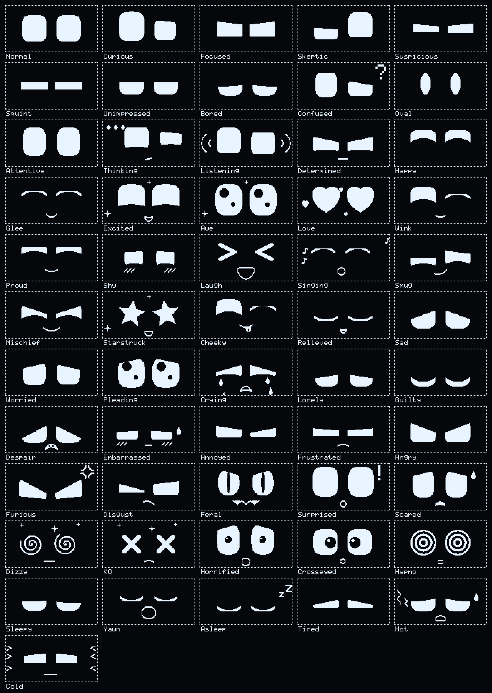
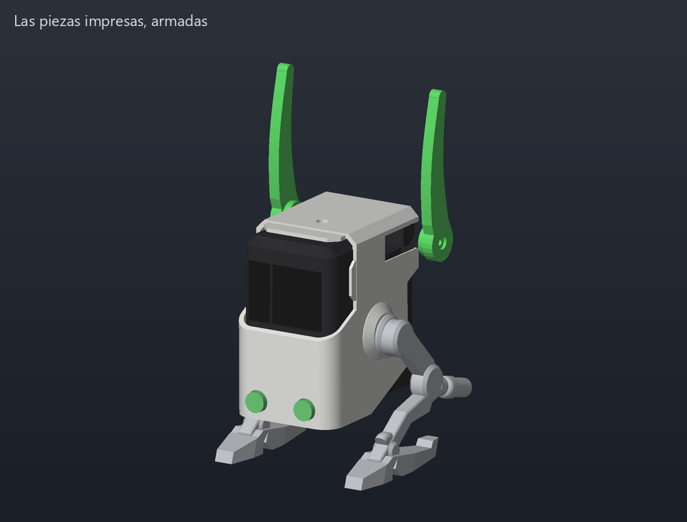
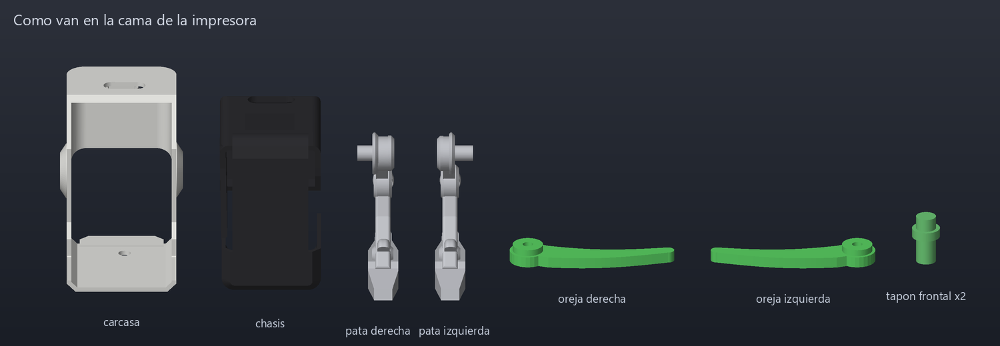
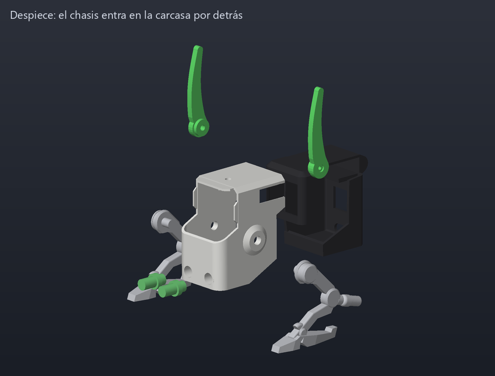
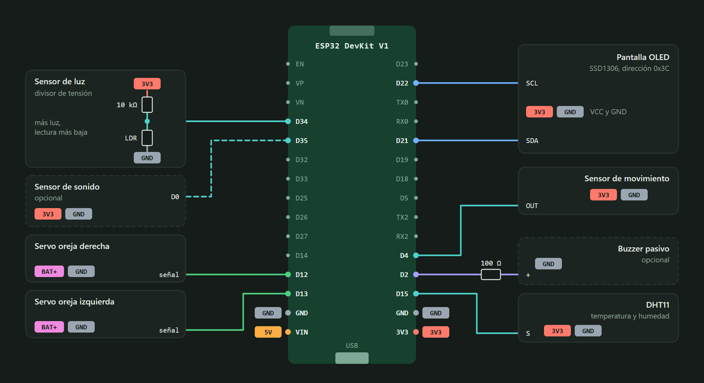
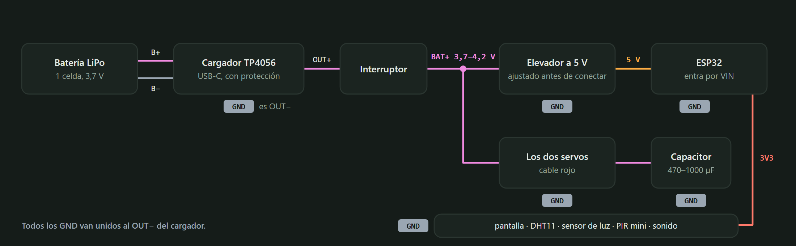
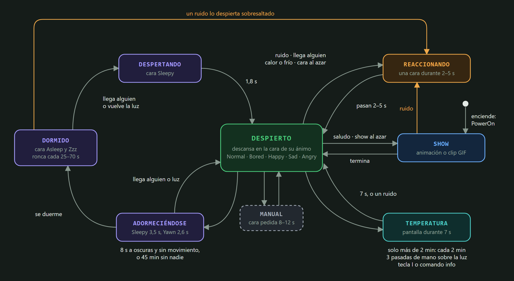
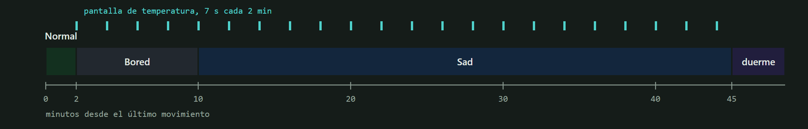

# Robot Eyes (ESP32)

Robot de escritorio con cara en una pantalla OLED 128x64, dos servos como orejas y
sensores (movimiento, luz, temperatura/humedad y, opcional, sonido).



Las caras **no son imágenes guardadas: se calculan con matemática** en cada cuadro, y
el robot pasa de una emoción a otra caminando por un **grafo de emociones** (la idea
del "Emotion Engine" de Eilik). Además de caras hace **animaciones**: juega al pong con
los ojos, sigue una mosca, estornuda, riega una planta... también calculadas. Todo el
firmware corre en **Windows**, dentro de un emulador que muestra el robot en 3D armado
a partir de los CAD de `doc/`. Las piezas para imprimirlo están en [`cad/stl/`](cad/stl)
(ver [Imprimir el cuerpo](#imprimir-el-cuerpo)).

| Qué | Cuántos | Dónde se ven |
| --- | --- | --- |
| Caras (nodos del grafo) | 56 | `doc/expressions/` |
| Animaciones calculadas ("acts") | 43 | `doc/animations/` |
| Clips (los GIF originales, comprimidos) | 24 | `../robot ojos/` |



---

## Probar en Windows (emulador)

Requiere `g++` (w64devkit) y raylib en `C:/raylib` — lo mismo que `car_game`.

```bash
cd emulator
make            # o mingw32-make
./robot_emu.exe
```

La ventana muestra el robot real (cuerpo, cabeza, patas, servos, ESP32, batería... salen
del CAD), la OLED encendida con lo que dibuja el firmware, las orejas moviéndose con el
ángulo que el firmware le escribe a cada servo, y a la derecha el panel:

| Zona | Qué muestra |
| --- | --- |
| OLED | Copia exacta de la memoria de la pantalla, y cuánto I2C costó cada cuadro |
| State | Ánimo, qué está haciendo el "cerebro", cara actual y la ruta por el grafo |
| Emotion graph | El grafo completo. **Click en un nodo** = ir a esa cara |
| State machine | Debajo del robot: el estado actual resaltado, la flecha del último cambio, **por qué** cambió y los relojes que van a disparar el próximo |
| Sensors | PIR, sonido, luz (LDR), temperatura y humedad: se mueven con el mouse |
| Actuators | Ángulo pedido y real de cada servo, si está energizado, y el buzzer |

| Tecla | Acción |
| --- | --- |
| `1`..`9` | Normal, Happy, Sad, Angry, Surprised, Asleep, Love, Dizzy, Laugh |
| `TAB` / `Shift+TAB` | Cara siguiente / anterior |
| `[` `]` y `0` | Elegir una animación o clip, y reproducirlo |
| `Y` / `U` / `H` | Decir que sí / decir que no / globo "HOLA!" |
| `M` (mantener) | Movimiento frente al PIR |
| `S` | Ruido fuerte (aplauso) |
| `L` | Apagar / prender la luz |
| `I` | Pantalla de temperatura |
| `A` | Comportamiento autónomo sí / no |
| `ALT` + mouse | Los ojos siguen al mouse |
| `SPACE` | Parpadear |
| `Q` | Mostrar / ocultar la máquina de estados |
| `X` | Vista: sólido → rayos X → solo el interior |
| `C` | Colores del robot impreso / colores del CAD |
| `R` | Grabar la OLED a un GIF (`emulator/captures/`) |
| `P` | Captura de pantalla |
| `F` (mantener) | Tiempo x20 |
| `ENTER` | Pausa |
| Mouse | Arrastrar = orbitar, rueda = zoom, botón derecho = mover, botón central = reset |

Cosas para probar: mantener `M` varias veces (se pone contento), `S` cuatro veces
seguidas (se asusta, después se enoja), `L` y esperar 8 s (bosteza y se duerme),
temperatura arriba de 31 °C (tiene calor).

> El emulador conecta un sensor de sonido **virtual** en GPIO35. En el robot real solo
> existe si se cablea uno (KY-037/038, salida D0) y se pone `PIN_MIC 35` en `Config.h`.

### Modo automático (capturas, pruebas)

```bash
./robot_emu.exe --script "2:expr=Love; 5:shot=love.png; 6:xray=1; 7:shot=xray.png; 7:quit"
```

Pasos `tiempo:comando=valor` separados por `;`. Comandos: `expr act say clip motion
light sound temp hum auto xray colors cam=yaw,pitch,dist info shot record quit`. El
tiempo es simulado, así que una hora de vida del robot se prueba en segundos. Las rutas
de `shot` tienen que ser absolutas.

### GIFs generados por matemática

`facetool.exe` es el mismo motor sin ventana; escribe lo que mostraría la OLED:

```bash
./facetool.exe gif Love love.gif            # de Normal a Love, por el grafo
./facetool.exe trip viaje.gif Normal Happy Furious Asleep
./facetool.exe act Pacman pacman.gif        # una animación
./facetool.exe say "HOLA DAVID" hola.gif    # el globo de texto
./facetool.exe strip Fly fly.gif 12         # 12 momentos de una animación en una hoja
./facetool.exe clip Boba boba.gif           # un clip guardado, decodificado por el motor
./facetool.exe path Furious Glee            # Furious -> Angry -> Normal -> Happy -> Glee
./facetool.exe list
make gifs                                   # todo -> doc/expressions/ y doc/animations/
```

---

## Imprimir el cuerpo



Los STL están en [`cad/stl/`](cad/stl), ya acostados en la posición de impresión:

| Archivo | Cant. | Qué es | Cómo va en la cama | Soportes |
| --- | --- | --- | --- | --- |
| `carcasa.stl` | 1 | La pieza blanca: frente, techo y costados | Con el techo abajo | Sí |
| `chasis.stl` | 1 | La pieza negra: marco de la pantalla, servos, ESP32, batería | Con el frente abajo | Sí |
| `pata_derecha.stl`, `pata_izquierda.stl` | 1 + 1 | Las patas (derecha mirando al robot de frente) | Paradas sobre la suela | Sí, en la cadera |
| `oreja_derecha.stl`, `oreja_izquierda.stl` | 1 + 1 | Las orejas verdes | Planas | No |
| `tapon_frontal.stl` | 2 | Los tapones de los dos agujeros de abajo del frente | Parado sobre la pestaña | No |



PLA a 0,2 mm con 15–20 % de relleno. Todas juntas pesarían unos 48 g macizas, así que
con relleno es bastante menos. Además:

- [`cad/esp32_eyes.step`](cad/esp32_eyes.step) es el robot entero, con la electrónica
  y las orejas, para abrirlo en cualquier CAD.
- [`cad/ensamblado/`](cad/ensamblado) tiene las mismas piezas en su lugar. Abiertas
  juntas en un visor de STL, se ve cómo cierra.

### Armado



1. **El chasis.** La pantalla en el marco, el ESP32 parado detrás, los dos servos arriba
   con los ejes hacia los costados, el DHT11 contra la ventana trasera, la batería en el
   medio y el cargador abajo con el USB-C hacia atrás. Los cables y una prueba después
   de cada pieza están en [`doc/circuito.html`](doc/circuito.html).
2. **La carcasa.** El chasis entra por detrás. En el CAD van sin holgura: si no entra,
   lijar el costado derecho por dentro (ver más abajo).
3. **Las patas.** El perno de la cadera va en el agujero redondo de cada costado. Si
   queda flojo, una gota de pegamento.
4. **Los tapones** en los dos agujeros de abajo del frente.
5. **Las orejas**, con el firmware cargado. Escribir `asleep` en la consola para que los
   servos vayan a la posición de oreja acostada. Encastrar cada oreja a presión en el
   eje, apuntando hacia atrás, y ajustarla con el tornillito que trae el servo. Después,
   `surprised` las para y `furious` las lleva hacia adelante. Si una va al revés, se
   corrige en `Config.h` (ver *Calibrar las orejas* más abajo).

### Lo que hay que saber

- **Las orejas son nuevas.** No estaban en el CAD: las genera `cad/export_stl.py` con la
  misma forma que las del emulador. Están medidas sobre el modelo del servo GH-S37D, que
  tiene el eje estriado de 3,5 mm. El agujero mide 3,4 mm para que entre a presión, y
  del otro lado tienen un rebaje para la cabeza del tornillo. Todavía no se imprimieron:
  si entra floja, una gota de pegamento; si no entra, repasar con una broca de 3,5 mm.
  El script comprueba que, girando de 0 a 180°, no tocan nada.
- **El resto sale tal cual del CAD** (`doc/Robot ESP32 V2 - copia.FCStd`), sin
  retoques. El script avisa dónde se tocan las piezas en el modelo
  ([`cad/export_stl.log`](cad/export_stl.log)):
  - La carcasa y el chasis comparten 133 mm³. Por el costado derecho están a ras, con
    0,2 mm de interferencia, y en la esquina delantera derecha se pisan hasta 1,9 mm.
  - El perno de cada pata entra con algo de interferencia en la carcasa o en el chasis
    (unos 25 mm³ cada una).
- Hay dos cuerpos del CAD que no se exportan, `Cuerpo042` y `Cuerpo055`: casi todo su
  volumen cae dentro del chasis y parecen ayudas de modelado.

Para regenerar todo después de cambiar el CAD (necesita FreeCAD 1.0):

```bash
"C:/Program Files/FreeCAD 1.0/bin/freecadcmd.exe" -c "exec(open('cad/export_stl.py').read())"
python tools/render_stl.py        # las imágenes de esta sección
```

El script elige solo la posición de impresión de cada pieza: la que deja menos
superficie en el aire, apoyada de forma estable.

---

## Cargar en el ESP32

Abrir `esp32-eyes.ino` en Arduino IDE (placa *ESP32 Dev Module*). Librerías: **U8g2**,
**ESP32Servo**, **DHT sensor library**. Con `arduino-cli`:

```bash
arduino-cli compile --fqbn esp32:esp32:esp32 .
arduino-cli upload  --fqbn esp32:esp32:esp32 -p COM3 .
```

Ocupa ~640 KB (48 % de la partición por defecto) con todas las caras, las animaciones y
los 24 clips.

### Pines (`Config.h`)

| Señal | GPIO | |
| --- | --- | --- |
| Servo oreja izquierda | 13 | izquierda mirando al robot de frente |
| Servo oreja derecha | 12 | |
| PIR | 4 | |
| LDR | 34 | analógico |
| DHT11 | 15 | |
| Buzzer pasivo | 2 | `-1` para desactivarlo |
| Sensor de sonido | `-1` | opcional |
| OLED SSD1306 | SDA 21 / SCL 22 | I2C a 400 kHz |

### Circuito



Cada etiqueta de color es un riel: todos los `3V3` van al pin 3V3 del ESP32, todos los
`GND` juntos, y `BAT+` es el positivo de la batería después del interruptor.



La guía completa está en [`doc/circuito.html`](doc/circuito.html): lista de piezas, tabla
de conexiones, armado paso a paso con una prueba después de cada pieza, los pines con
trampa y qué revisar si algo falla.

**Calibrar las orejas:** el motor trabaja con un ángulo lógico (0 = acostada hacia atrás,
90 = parada, 150 = hacia adelante). `EAR_LEFT_ZERO / EAR_LEFT_DIR` y los `RIGHT` lo
convierten al ángulo de cada servo. Si una oreja se mueve al revés, cambiar su `DIR`.

### Consola serie (115200)

```
happy | love | furious | asleep ...   ir a esa cara
act pacman                            reproducir una animación
say HOLA DAVID                        globo de texto (hasta 20 letras)
clip boba                             reproducir un clip
list                                  caras, animaciones y clips disponibles
status                                qué siente y qué leen los sensores
info                                  pantalla de temperatura
auto on|off     mute on|off
```

---

## Cómo está hecho

```
 sensores ──► Brain ──────────► FaceEngine ──► Canvas 128x64 ──► OLED
 (Sensors)   ánimo, reacciones   grafo, morph,                   (solo lo que cambió)
                  │              parpadeo, mirada
                  ├──────────► Ears   (servos con suavizado)
                  └──────────► Buzzer (chirridos)
```

| Carpeta | Contenido |
| --- | --- |
| `src/core` | `Canvas` (framebuffer de 1 bit), fuente 5x7, easing, resorte, ruido |
| `src/face` | Modelo del ojo, rasterizador, decoraciones, tabla de expresiones, grafo, animaciones, motor |
| `src/clips` | Reproductor de clips y `ClipData.cpp` (generado desde los GIF) |
| `src/body` | Orejas y buzzer |
| `src/brain` | Sensores, comportamiento y pantalla de temperatura |
| `emulator` | Mocks de Arduino / U8g2 / ESP32Servo / DHT, escena 3D, `facetool` |
| `tools` | `gif2clip.py`, `export_cad.py` |
| `legacy` | El motor anterior (no se compila) |

`src/core`, `src/face` y `src/clips` no usan nada de Arduino: reciben el tiempo por
parámetro. Por eso los mismos píxeles salen en el ESP32, en el emulador y en los GIF.

### El ojo

Un ojo es una **superelipse** recortada por dos párpados (`src/face/FaceTypes.h`):

| Parámetro | Efecto |
| --- | --- |
| `x, y, w, h` | Posición y tamaño |
| `nTop, nBot` | Forma de la mitad de arriba / abajo: 2 = óvalo, 4 = redondeado, 8 = casi rectángulo |
| `lidT, lidTAng, lidTBend` | Párpado superior: cuánto cierra, inclinación (+ = enojado), curvatura |
| `lidB, lidBAng, lidBBend` | Párpado inferior: cuánto sube, inclinación, curvatura (+ = sonrisa) |
| `pupil, pupilW, px, py` | Pupila opcional: tamaño, ancho (0.25 = de gato) y posición. Sigue la mirada |

Como todo son números, dos caras cualesquiera se pueden **mezclar** parámetro por
parámetro: eso es la transición. Los ojos que no son una forma (corazón, estrella,
espiral, anillos, X, `> <`) se cambian con un "aplastar, cambiar, abrir". Encima de la pose van las capas de
vida: parpadeo, mirada errante con perspectiva falsa, movimiento propio de cada emoción
(rebote, temblor, cabeceo...) y decoraciones animadas (Zzz, lágrimas, corazones, sudor,
notas, estrellas...), todas funciones del tiempo.

### El grafo

56 caras y 112 conexiones en 6 grupos (Normal, Happy, Sad, Angry, Alert, Sleepy).
`goTo(cara)` busca el camino más corto y lo recorre nodo por nodo; los nodos intermedios
se pasan rápido. Si llega un pedido nuevo a mitad de camino, sale desde la pose que está
en pantalla, sin saltos.

**Agregar una cara:**

1. Sumarla al `enum ExprId` (`src/face/FaceTypes.h`).
2. Definirla en la tabla de `src/face/Expressions.cpp`, **en el mismo orden** del enum.
3. Conectarla en `src/face/ExpressionGraph.cpp`: `{EX_NUEVA, EX_VECINA, 300, CALM}`.
4. `make` en `emulator/` y mirarla.

### Las animaciones ("acts")

Igual que los GIF cuentan una pequeña historia, pero son una **función del tiempo**: no
guardan cuadros. Cada una empieza y termina en una cara del grafo, así que el motor
camina hasta esa cara, la reproduce y sigue viaje.

| Tipo | Animaciones |
| --- | --- |
| Gestos | `Yes` `No` `EyeRoll` `Peek` `Dash` `Exclaim` `Thinking` `Read` `Sneeze` |
| Efectos de pantalla | `Glitch` `PowerOn` `Reboot` `Scanner` `Matrix` |
| Con objetos | `Notify` `Orbit` `Swirl` `Burst` `Heartbeat` `Rain` `ShootingStar` `Fireworks` `Snore` `Loading` `Bubbles` `Say` `Fly` `Ball` `Hula` `Dance` `Plant` `Drink` |
| Vida diaria | `Book` `Headphones` `Butterfly` `Coffee` `Sunglasses` `Rocket` `Snow` `Search` `Photo` |
| Juegos | `Pacman` `Pong` |

Una animación son dos funciones (`src/face/Acts*.cpp`):

```cpp
// Mueve la cara. `f` llega con la pose de la cara base; f.t es el tiempo en segundos.
void actYesPose(ActFrame &f) {
  float k = envelope(f, 0.2f, 0.35f);              // entra y sale suave
  f.dy[0] = f.dy[1] = 7.0f * sinf(f.t * 10.7f) * k; // los dos ojos suben y bajan
  if (f.crossed(0.2f)) f.chirp = CH_HAPPY;         // sonido, una sola vez
}
// Dibuja los objetos: detrás de los ojos, delante, o como efecto sobre el cuadro.
void actYesDraw(Canvas &c, const ActFrame &f, const FaceFrame &face, uint8_t layer) {}
```

**Agregar una animación:** escribir las dos funciones, declararlas en `ActList.h` y
sumar una línea a la tabla de `Acts.cpp`:

```cpp
ACT(Yes, 1.9f, EX_NONE, ON_REQUEST),   // nombre, segundos, cara base, ánimos que la eligen
```

`EX_NONE` como cara base = se reproduce sobre la cara que tenga puesta. Como dependen
solo del tiempo, `facetool strip <nombre> hoja.gif` las muestra completas sin esperar.

### El comportamiento

Dos sentimientos lentos deciden el ánimo: `social` (sube cuando hay gente moviéndose) y
`annoy` (sube con los ruidos). Los eventos disparan reacciones cortas y entre eventos el
robot pasea por las caras vecinas a su ánimo, hace una animación que le quede bien a ese
ánimo (30 % de las veces) o reproduce un clip (10 %).

| Situación | Reacción |
| --- | --- |
| Se enciende | La pantalla prende como un televisor viejo (`PowerOn`) |
| Aparece la primera persona | Globo "HOLA!" |
| Alguien aparece | Curious; si ya está contento saluda (Glee, Wink, Love...) |
| Vuelve alguien después de 10 min solo | Fuegos artificiales o un corazón |
| Duerme | Cada tanto ronca con una burbuja (`Snore`) |
| Ruido | Surprised → Scared → Angry → Furious si se repite |
| 2 min sin nadie | Bored |
| 10 min sin nadie | Sad, y cada 2 min muestra la temperatura |
| 45 min sin nadie, o 8 s a oscuras | Sleepy → Yawn → Asleep |
| Pasar la mano 3 veces sobre el sensor de luz | Pantalla de temperatura |
| Más de 31 °C / menos de 12 °C | Hot / Cold |

Los tiempos están en `Config.h`.

#### Máquina de estados



Las flechas naranjas son ruidos. A `MANUAL` se entra desde cualquier estado con un comando
por serie o un click en el emulador. El emulador dibuja este mismo diagrama en vivo
(tecla `Q`), con el estado actual resaltado y el motivo del último cambio; por serie,
`status` dice lo mismo en texto.

Sin nadie cerca, a escala (45 minutos de izquierda a derecha):



El detalle completo (qué hace cada sensor en cada estado, cómo saluda, la escalera de
enojo, cuándo muestra la temperatura) está en
[`doc/maquina-de-estados.html`](doc/maquina-de-estados.html): se abre con doble click.
Sale de `src/brain/Brain.cpp`; si cambia el comportamiento hay que actualizarlo.

### Clips (GIF)

Los GIF de `../robot ojos` se convierten a clips comprimidos (cuadro clave o diferencia
XOR con el anterior + RLE): 1.5 MB en crudo quedan en 233 KB.

```bash
python tools/gif2clip.py "../robot ojos" -o src/clips/ClipData.cpp
python tools/gif2clip.py "../robot ojos" --skip "nyan|IMG_" -o src/clips/ClipData.cpp
```

Todos empiezan y terminan con ojos ovalados, así que el motor va a la cara `Oval`,
reproduce el clip y sigue su camino por el grafo.

### Modelo 3D

`tools/export_cad.py` abre el archivo de FreeCAD sin interfaz, convierte cada pieza a
triángulos con los colores del CAD y las deja en `emulator/assets/robot/`:

```bash
"C:/Program Files/FreeCAD 1.0/bin/freecadcmd.exe" -c "exec(open('tools/export_cad.py').read())"
```

La tabla `ROLES` del script dice qué es cada objeto (carcasa, cabeza, servo...). El eje
de los servos y el área encendida de la pantalla se miden sobre las mallas, así que al
mover piezas en el CAD y exportar de nuevo el emulador se acomoda solo. Las orejas
verdes no están en el CAD: el emulador las genera, y `cad/export_stl.py` hace las de
imprimir con la misma forma (ver [Imprimir el cuerpo](#imprimir-el-cuerpo)).

---

## Qué cambió respecto del motor anterior

| Problema | Ahora |
| --- | --- |
| La transición mezclaba sobre sí misma cada cuadro, con enteros: dependía de los FPS y se trababa | Se guarda la pose de origen y se interpola con easing |
| 10 cuadros por segundo: un parpadeo de 180 ms casi no se veía | 30 cuadros por segundo |
| Los campos `Inverse_Radius_*` nunca se dibujaban: "feliz" era un rectángulo | Párpados curvos: arcos, medias lunas |
| Emoción al azar cada 15 s (de furioso a feliz de golpe) | Grafo de emociones + ánimo |
| 18 caras, solo cambios de forma | 56 caras, con pupilas, boca y decoraciones, más 43 animaciones |
| Servos con secuencias bloqueantes, hasta 13 s después del cambio de cara | Orejas sincronizadas con la cara, con suavizado, y se sueltan al quedar quietas |
| `currentState` compartido entre 3 tareas sin protección | Un solo lazo, sin tareas |
| Se mandaba la pantalla completa por I2C | Solo los bloques de 8x8 que cambiaron |
| Umbral de luz que arrancaba en 10 y mandaba a dormir por ruido del ADC | Rango aprendido + histéresis |
| Pin 2 usado a la vez como buzzer y como sensor de sonido | Pines separados |
| Los GIF ocupaban 1.5 MB | 233 KB, los 24 entran |
